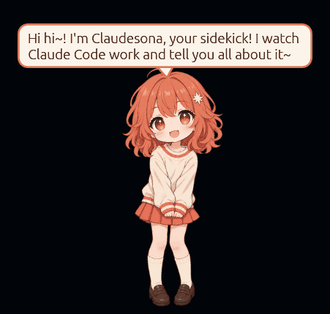
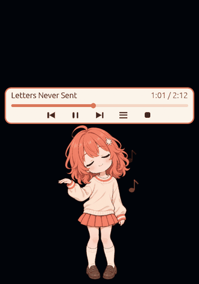
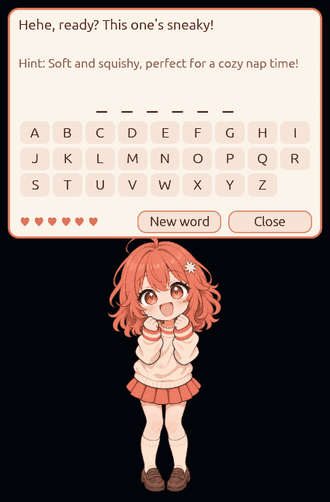
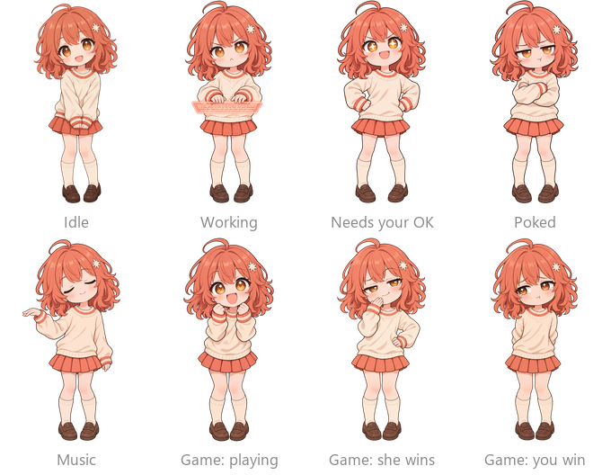

# Claudesona

A chibi desktop mascot for Claude Code on Windows. While Claude works she shows what it's doing, retells its replies in her own cheerful voice, and waves you over when Claude needs your permission. When things get quiet she plays music for you, and she's always up for a word-guessing game.

<p align="center"></p>

## What she does

### Follows Claude Code

She watches your Claude Code session and changes pose with it:

- **Working**: she types on a glowing keyboard and shows what Claude is doing, like "Reading main.rs…" or a line about the command that's running (tests, builds, git, installs and more).
- **Needs your OK**: when Claude asks for permission she puts her hands on her hips, a "!" pops up, and she calls you.
- **Done**: Claude's final reply comes back rewritten in her voice. Click the bubble for the longer version.
- **Helpers**: every sub-agent Claude starts gets its own mini Claudesona by her feet, with a little "done!" when it finishes.

<p align="center"></p>

### Plays music

After 5 quiet minutes she puts on music by herself, or pick **Play music** from her right-click menu. A small player sits above her head: song name, time, a progress bar you can click to jump, previous, play/pause, next, the song list and stop.

There are six slow, chill songs, each with a written melody that phrases like sung lyrics. They're synthesized inside the app while it runs. There are no audio files and no downloads, so there's nothing to license:

| Song | Feel |
| :- | :- |
| Rainy Window Seat | electric piano chords, a hummed melody, lazy boom-bap beat |
| Last Bus Home | vibraphone chords, piano melody, soft boom-bap |
| Sunday Matcha | piano and music box, soft shaker |
| Night Shift Neon | warm pad and electric piano, slow R&B groove, deep 808 bass |
| Letters Never Sent | slow ballad, strings and flute |
| Moonlit Walk Home | slow ballad, piano |

<p align="center"></p>

### Plays with you

Pick **Play with me** and she starts a game of hangman. Claude (Haiku) picks a word and writes a hint, and you guess by clicking letters. You get six hearts. She cheers, teases and reacts to every guess, looks smug when she wins, and sulks a little when you do.

<p align="center"></p>

### Her poses

<p align="center"></p>

## Install on a machine

Needs Windows 10 or 11 and Claude Code. The `claude` command must be on PATH for her in-character rewrites and the word game. Without it she shows Claude's plain text, and the game uses a short built-in word list.

1. Copy `claudesona.exe` to the machine. It's a single file with the art built in.
2. Run `claudesona.exe install` from a terminal.

`install` does three things:
- copies the exe to `%LOCALAPPDATA%\Programs\Claudesona\`
- adds five hooks (`SessionStart`, `SessionEnd`, `Notification`, `PermissionRequest` and `PreToolUse` for Bash/PowerShell) to `~/.claude/settings.json`, after saving a backup as `settings.json.claudesona-backup`
- starts her

From then on she starts with every new Claude Code session. Sessions that were already open need a restart.

To update, run `install` again with the new exe. It replaces the running copy.

## Uninstall

Run `claudesona.exe uninstall`. It removes her hooks (and nothing else) from `settings.json` and closes her. Then delete `%LOCALAPPDATA%\Programs\Claudesona`.

## Using her

- **Drag** to move her. She remembers the spot.
- **Click** her to poke her.
- **Click** her reply bubble to show the longer version.
- **Double-click** her to bring back the terminal you last sent a prompt from.
- **Right-click** for the menu:
  - **Size**: S, M or L
  - **Play music** / **Stop music**
  - **While working**: show her working pose or her music pose while Claude works
  - **Play with me**: the word game
  - **What can I do**: she introduces herself and shows each of her poses
  - **Hide for 10 min**: she keeps following Claude, invisible and click-through
  - **Quit**: until the next Claude Code session
- Clicks anywhere else pass through to the windows behind her.

Size, position and the "While working" choice are remembered.

## Custom art

Make a `skin` folder next to the installed exe (`%LOCALAPPDATA%\Programs\Claudesona\skin`) and put your PNGs in it, then restart her:

| File | Shown when | If missing |
| :- | :- | :- |
| `idle.png` (required) | nothing is happening | the skin is ignored |
| `idle_blink.png` | idle, eyes closed for a blink | no blinking |
| `working.png` | Claude is working | `idle.png` |
| `working_blink.png` | working, eyes closed | no blinking |
| `waiting.png` | Claude needs your OK | `idle.png` |
| `poke.png` | you click her | `idle.png` |
| `music.png` | music is playing | `idle.png` |
| `game_excited.png` | you're playing the word game | `idle.png` |
| `game_excited_blink.png` | playing, eyes closed | no blinking |
| `game_smug.png` | she won the game | `waiting.png` |
| `game_pouty.png` | you won the game | `poke.png` |

- If `idle.png` is there, the whole skin replaces the built-in art; skin and built-in images are never mixed.
- Every image: one full-body character standing on the bottom edge, transparent background, all on the same canvas size and framing. Any portrait size works, e.g. 1024×1536.
- The animation bends fixed parts of the image: the head tilts around a neck point 38% from the top, hair swings at the sides between chin and shoulders, and the skirt hem at 52–72% from the top. In the music pose, the raised hand on the viewer's left (about shoulder height) sways to the beat. Art laid out differently still shows, but the motion may look odd.
- Her clickable area is her non-transparent pixels.
- `assets/PROMPTS.md` has the AI image prompts used for the built-in art.

## Build

```
cargo build --release      # target\release\claudesona.exe is the file to ship
cargo test
```

## Limits

- She reads Claude Code session logs on the Windows side only. Claude Code running inside WSL isn't supported yet.
- Each reply rewrite and each new game word is a small `claude -p` call (Haiku) on the user's Claude plan.
- Music volume follows the Windows mixer only.
